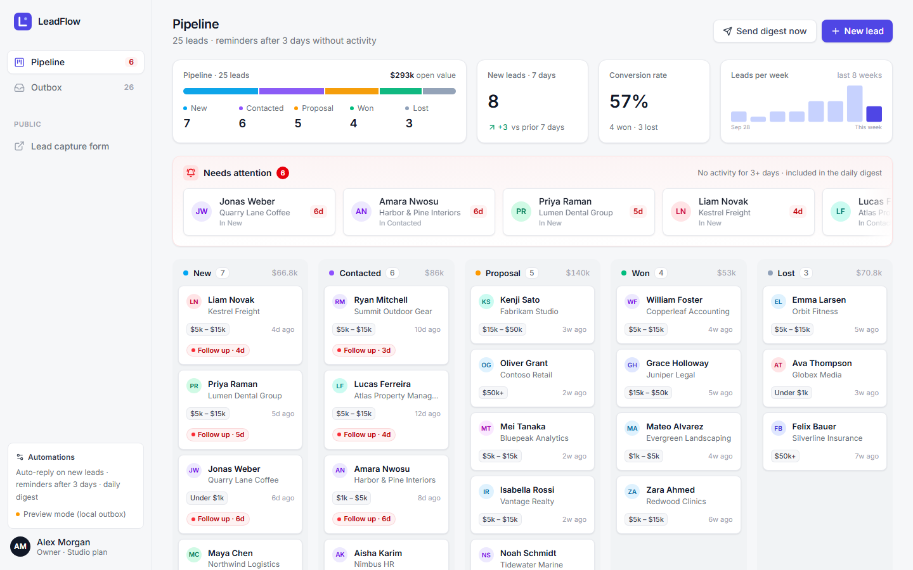
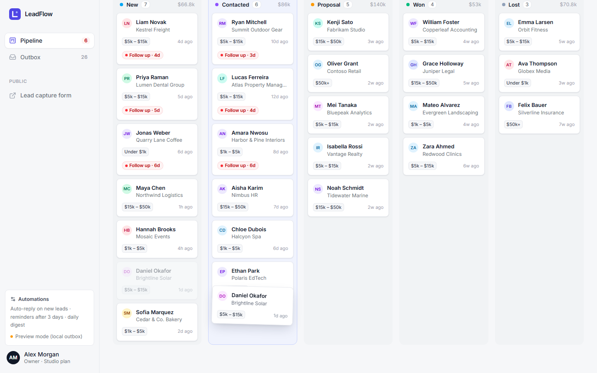
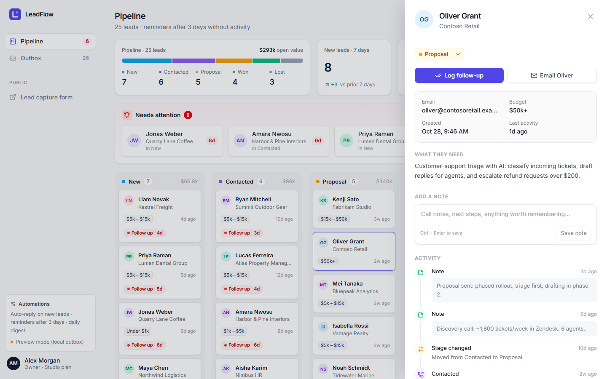
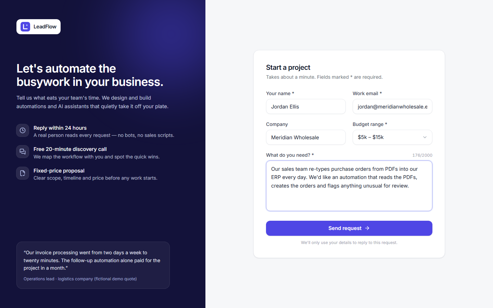
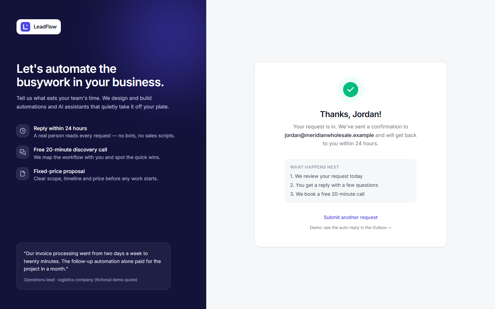
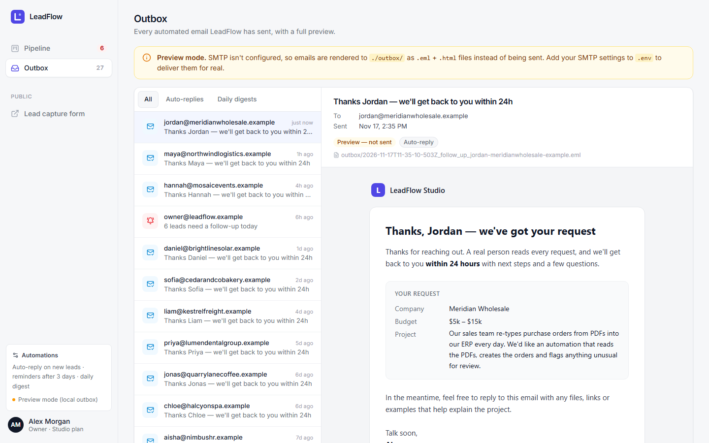
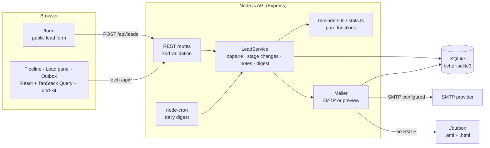

# LeadFlow — a mini CRM with automated follow-ups

LeadFlow captures leads from a public form, replies to them instantly, and makes sure none of them go cold.
It is a small, complete app: a lead form, an automatic follow-up email, a drag-and-drop pipeline, reminders
for quiet leads, and a daily digest email for the owner.

It runs locally with **one command and zero setup**. There is no external database and you don't need an email
account. Without SMTP settings, every email is rendered to a local outbox that you can read inside the app.



## Features

| | |
|---|---|
| **Public lead form** (`/form`) | Name, email, company, project description and budget range. It validates in the browser and on the server with the same zod schema, so the error messages always match. Submitting shows a clear success state. |
| **Instant auto-reply** | Every new lead gets a "thanks, we'll get back to you within 24h" email right away, sent through Nodemailer. If sending fails, the failure is logged on the lead's timeline and the lead is still saved. |
| **Pipeline board** (`/`) | Kanban columns: New → Contacted → Proposal → Won / Lost. Drag a card to change its stage; the board updates instantly and rolls back if the server rejects the change. Keyboard dragging works too. Each card shows the name, company, budget and how long ago the lead came in. |
| **Lead panel** | Click a card to open the lead's details, notes and a timeline of everything that happened (created, emailed, stage changes, notes). A one-click **Mark contacted** action is included. The URL tracks the open lead (`/?lead=14`), so you can share a link to it. |
| **Reminders** | A lead in New or Contacted with no activity for *N* days (default 3) gets a red **Follow up** badge and is listed under **Needs attention** at the top of the board. |
| **Daily digest** | A scheduled job (node-cron, default 08:00) emails the owner a list of leads that need attention. You can also trigger it from the UI with **Send digest now**. |
| **Dashboard strip** | Lead count per stage, open pipeline value, conversion rate, new leads in the last 7 days compared with the 7 days before, and a weekly chart drawn in plain SVG (no chart library). |
| **Outbox** | Every automated email with a full HTML preview, filterable by type. In preview mode each one is also saved as a standard `.eml` file that opens in any mail client. |

| Drag and drop | Lead details & timeline |
|---|---|
|  |  |

| Public lead form | Success state |
|---|---|
|  |  |



## Quick start

Requires **Node.js 20+**.

```bash
npm install
npm run dev
```

Open **http://localhost:5173**. On first start the database is empty, so 25 fictional demo leads are added
automatically. The public form is at **http://localhost:5173/form**.

| Command | What it does |
|---|---|
| `npm run dev` | API (port 3001, auto-restart on change) + web app (Vite, port 5173) |
| `npm run seed` | Reset the database and outbox, then load the demo dataset |
| `npm test` | Run the test suite (Vitest + Supertest) |
| `npm run typecheck` | Type-check the server and the web app |
| `npm run build && npm start` | Production build, served as one Node process on http://localhost:3001 |
| `npm run screenshots` | Regenerate the screenshots above (needs `npx playwright install chromium` once) |

### Configuration

All settings are optional. Copy `.env.example` to `.env` to change any of them.

| Variable | Default | Purpose |
|---|---|---|
| `FOLLOW_UP_AFTER_DAYS` | `3` | Days without activity before a lead is flagged |
| `DIGEST_CRON` | `0 8 * * *` | When the daily digest is sent (cron syntax) |
| `OWNER_EMAIL` / `OWNER_NAME` | demo values | Who receives the digest and who signs the auto-reply |
| `SMTP_HOST`, `SMTP_PORT`, `SMTP_SECURE`, `SMTP_USER`, `SMTP_PASS` | empty | Fill these in to send real email (Postmark, SES, Mailgun, Gmail, …) |
| `MAIL_FROM` | `LeadFlow Studio <hello@…>` | Sender address |
| `DATABASE_PATH` / `OUTBOX_DIR` | `./data/leadflow.db` / `./outbox` | Where data and email previews are stored |

No credentials are stored in the code. Secrets come only from the environment. The `/api/config` endpoint
exposes the non-secret settings only, and a test checks that.

## Architecture



```
shared/      domain types + zod schemas (used by both API and UI)
server/      Express API, SQLite repositories, services, mailer, scheduler, seed data
web/         React app (Vite + Tailwind CSS v4)
tests/       unit tests for the reminder rules + API integration tests
scripts/     Playwright screenshot script
```

Design decisions:

- **One schema, two consumers.** `shared/domain.ts` holds the zod schemas and the API types. The form, the API
  validation and the TypeScript types can't drift apart.
- **Business rules are pure functions.** The rules for when a lead is stale and how the dashboard numbers are
  calculated live in `reminders.ts` and `stats.ts`. They take a `now` argument and do no I/O, so they are easy to
  test. The service layer gets its clock injected, which lets the tests move time forward ("3 days later…")
  without mocking `Date`.
- **Thin routes, explicit wiring.** Route handlers only translate between HTTP and service calls.
  `container.ts` builds everything in one place, and the server, the seed script and the tests all reuse it.
- **Emails are first-class records.** Every message is stored with its HTML, whichever transport sent it.
  The Outbox therefore works the same in preview and production, and each lead's timeline can link to the exact
  email it received.
- **Safe by default.** User input is escaped in email HTML (a test checks this). Email previews render in a
  sandboxed iframe. The seed script never sends real email, even when SMTP is configured. Demo addresses use the
  reserved `.example` domain.

## Tests

```
✓ tests/reminders.test.ts   stale-lead rules, thresholds, ordering, edge cases
✓ tests/api.test.ts         lead capture, validation, auto-reply + outbox files, HTML escaping,
                            stage changes, notes, reminders over time, digest, dashboard numbers
```

The API tests use an in-memory SQLite database, a temporary outbox folder and a controllable clock, so they are
fast and leave nothing behind.

## What I'd add for a client

This demo is deliberately small. For a production deployment I would typically add:

- **Authentication & team accounts.** Login (magic link or SSO), several users, assigning leads to people, and
  per-user reminders.
- **Integrations where the leads already are.** Webhooks from Typeform, Webflow or WordPress, inbound email
  parsing, two-way sync with HubSpot, Pipedrive or Airtable, and Slack or Teams notifications for new and stale
  leads.
- **Smarter follow-ups.** Multi-step email sequences that stop when the lead replies, reply detection via IMAP or
  the provider's webhooks, and send-time scheduling in the lead's timezone.
- **AI assist.** Lead scoring and qualification from the project description, first-reply drafts for a person to
  approve, and summaries of long email threads.
- **Reliable delivery.** A job queue (BullMQ / pg-boss) with retries, a transactional email provider with bounce
  and complaint handling, and SPF/DKIM/DMARC set up for the client's domain.
- **Ops.** Postgres instead of SQLite, Docker plus a CI pipeline, error tracking (Sentry), audit logs, backups and
  GDPR tooling (export and delete a contact).

## License

MIT — see [LICENSE](LICENSE). All names, companies and quotes in the demo data are fictional.
